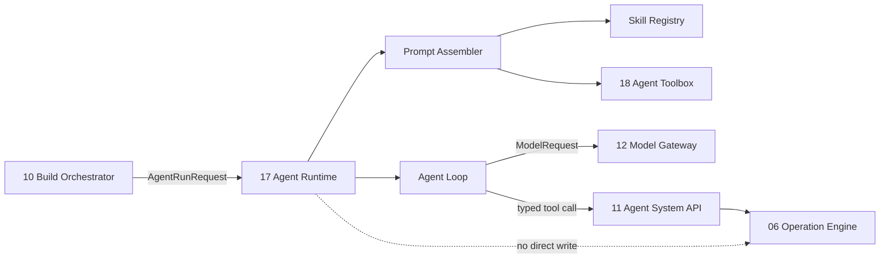
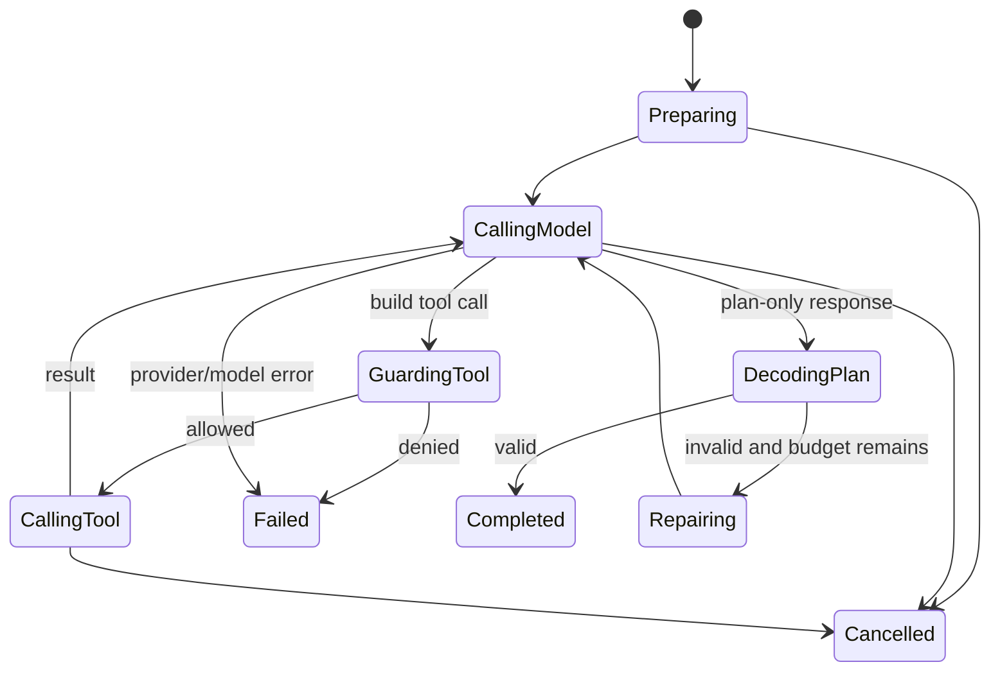

# 17 Agent Runtime 模块设计

- 所有权：Rust/Tokio
- 建议 crate：`crates/agentos-agent-runtime`
- 兼容目标：借鉴 Hermes 的分层 Prompt 与渐进式 Skills，但不依赖 Hermes Python Runtime
- 上游：Build Orchestrator
- 下游：Agent Toolbox、Model Gateway、Agent System API

## 1. 目标

Agent Runtime 将 BuildTask 转换为受能力约束、可取消、可审计的模型会话。它负责：

1. 从类型化 Runtime 事实组装稳定且可测试的 Prompt；
2. 从 Agent Toolbox 投影当前可用 Element、Recipe 和受限命令；
3. 以紧凑索引发现 Skill，并按需加载受信任内容；
4. 在 plan-only 模式生成结构化方案，不产生任何领域写入；
5. 在后续 build 模式协调模型 tool call，但只允许调用 Agent System API；
6. 管理上下文预算、轮次、取消、模型输出校验和会话结果；
7. 保持模型供应商、GUI Domain、Repository 和持久化实现解耦。

## 2. 非目标

本模块不：

- 直接修改 `GuiDocument` 或提交 `OperationTransaction`；
- 直接访问 Repository、SQLite、Tauri command、文件系统或 Shell；
- 保存或解析模型 API Key；
- 实现 HTTP provider adapter；
- 启动本地程序或请求桌面权限；
- 执行 Skill 附带的脚本、模板或任意代码；
- 限制 Agent 生成的应用代码所使用的语言、依赖、URL 或实现策略；
- 把模型输出视为可信领域对象；
- 复刻 Hermes 的通用电脑 Agent 工具集。

## 3. 模块边界



依赖方向：

```text
agentos-agent-runtime
  -> agentos-application ports
  -> agentos-contracts
  -> agentos-toolbox read contracts
  -> agentos-agent-api client contracts

agentos-model-* adapters
  -> agentos-application ModelGateway port
```

`agentos-agent-runtime` 禁止依赖 SQLx、SQLite adapter、Tauri shell/fs plugin 和 provider SDK。

上述限制只约束 Agent Runtime 自身。PoC 的 Build Agent 可以生成任意应用代码；代码由独立 Generated App Runtime 保存、构建和执行。Agent Toolbox 只限制最终 Surface UI 使用的 Element，不作为代码生成策略或依赖 allowlist。

### 3.1 所有权矩阵

| 状态或动作 | 唯一所有者 | Agent Runtime 的角色 |
| --- | --- | --- |
| AgentSession 创建、注册、过期和撤销 | Build Orchestrator | 消费不可变 session descriptor；不签发或延长 session |
| capability 与 resource scope 计算 | Build Orchestrator | 只将已签发 capability 投影为模型可见工具 |
| capability、scope、限流与幂等执行检查 | Agent System API | 发起带 session context 的调用；不能绕过检查 |
| Agent 模型轮次与上下文预算 | Agent Runtime | 唯一所有者 |
| pending confirmation 创建与持久化 | Build Orchestrator | 通过 Agent System API 请求确认并暂停相关步骤 |
| confirmation 接受或拒绝 | Shell 代表用户 | 只消费已解析结果；不能代表用户决策 |
| validation token 生成与验证 | Agent System API | 传递 token；不解释、不修改、不持久化 token |
| 领域 revision 与原子提交 | Operation Engine | 不持有直接写入句柄 |

Build Orchestrator 的 session registry 是 session 状态的唯一事实源。取消顺序固定为：撤销 session capability、拒绝新 API 调用、停止 Agent Runtime、终止 Worker。Runtime 本地的“running”状态不能证明 session 仍有效。

## 4. 核心模式

```rust
pub enum AgentRunMode {
    PlanOnly,
    Build,
}
```

### 4.1 PlanOnly

- capability 上限为 `surface.read`、`surface.tree.read`、`build.read`、`toolbox.read`；
- Model Gateway 的 `tools` 必须为空，或仅提供明确的只读查询工具；
- 禁止 `operation.validate`、`operation.commit` 和任何 native request；
- 结果只能是通过 Schema 校验的 `AgentPlan`；
- Runtime revision 在调用前后必须一致；
- UI 明确显示“未执行任何变更”。

### 4.2 Build

- 只在后续切片启用；
- capability 由 Host 根据任务签发，不由 Prompt 或模型声明；
- 模型只能提交 Agent Toolbox 暴露的高层命令；首期仅为 `element.add/remove`；
- Toolbox 将命令编译成 `OperationTransactionDraft`，再由系统内部调用 `operation.validate` 预检；
- commit 需要有效 validation token，并遵守用户确认结果；
- Agent Runtime 不持有绕过 Agent System API 的写入句柄。

Build 模式不属于首期 MVP。在 session、确认、validation token 和 cancel/commit race 的 contract tests 完成前，不得通过 feature flag 或隐藏入口开放。

## 5. 内部组件

| 组件 | 职责 |
| --- | --- |
| `AgentRuntime` | 会话入口、模式选择、取消和最终结果 |
| `PromptAssembler` | 分层组装稳定 Prompt 与动态消息 |
| `RuntimeDescriptorProvider` | 从代码事实生成 Runtime 能力描述 |
| `ToolboxProjector` | 从 Toolbox Catalog 投影当前模式可见的 Element、Recipe 和命令 |
| `CapabilityProjector` | 将 Host capability 投影为模型可见方法 |
| `SkillRegistry` | 枚举受信任 Skill、解析元数据和优先级 |
| `SkillSelector` | 根据任务、平台、模式和 capability 选择 Skill 索引 |
| `SkillLoader` | 按需加载并限制 Skill 正文大小 |
| `ContextBudgeter` | 控制 Prompt、历史、Skill、工具结果和输出预算 |
| `AgentLoop` | 模型轮次、tool call 分发、终止条件和取消 |
| `PlanDecoder` | 解析并校验 plan-only 结构化输出 |
| `ToolCallGuard` | 校验方法名、参数、session scope 和模式 |
| `PromptDiagnostics` | 生成无 Secret 的层级、哈希和 token 估算 |

## 6. 公共接口

```rust
#[async_trait]
pub trait AgentRuntime: Send + Sync {
    async fn run(
        &self,
        request: AgentRunRequest,
        events: Box<dyn AgentEventSink>,
        cancellation: CancellationToken,
    ) -> Result<AgentRunResult, AgentRuntimeError>;
}
```

```rust
pub struct AgentRunRequest {
    pub mode: AgentRunMode,
    pub task: AgentTaskContext,
    pub runtime: RuntimeDescriptor,
    pub capabilities: CapabilitySet,
    pub surface: SurfaceSnapshot,
    pub model_profile: ModelProfileId,
    pub limits: AgentRunLimits,
    pub correlation: AgentCorrelation,
}
```

```rust
pub enum AgentRunResult {
    Plan(AgentPlan),
    Build(BuildRunSummary),
}
```

关键不变量：

- `mode == PlanOnly` 时结果只能是 `AgentRunResult::Plan`；
- capability 由 Host 注入，模型输出不能扩大 capability；
- `surface.revision` 是方案和验证的基准；
- 任何 tool call 都带 session、task 和 correlation ID；
- 达到轮次、字节、token 或 deadline 上限时必须终止。

### 6.1 写调用并发与重放不变量

后续 Build 模式必须同时满足：

1. 每个写 tool call 携带 `sessionId`、`buildTaskId`、`baseRevision`、`correlationId` 和 `idempotencyKey`；
2. validation token 绑定 session、task、规范化草案哈希、base revision、确认级别和过期时间；
3. commit 仅在 session 有效、当前 revision 等于 base revision、确认记录已接受且 token 未过期时执行；
4. 同一 idempotency key 只能重放第一次请求的结果，参数不同则拒绝；
5. 模型重试、provider 断流或 Worker 恢复不得隐式重放新的写请求；
6. cancel 与 commit 竞争时，以 Agent System API 检查 session registry 的时刻为提交门；session 已撤销则 commit 必须失败；
7. revision drift 后旧 token 永久失效，Runtime 必须重新读取、重新规划并重新 validate；
8. confirmation 记录由 Build Orchestrator 持久化，Shell 是唯一 resolver，Runtime 不能缓存一个可替代权威记录的布尔值。

## 7. Runtime Descriptor

Runtime 说明不能由手写长 Prompt 单独维护。`RuntimeDescriptor` 是 Agent Prompt、`system.describeCapabilities`、调试视图和 contract test 的共同事实源。

```rust
pub struct RuntimeDescriptor {
    pub api_version: String,
    pub product: String,
  pub toolbox_version: ToolboxVersion,
    pub supported_elements: Vec<ElementDescriptor>,
  pub app_recipes: Vec<RecipeDescriptor>,
    pub layout: LayoutDescriptor,
    pub methods: Vec<AgentMethodDescriptor>,
    pub invariants: Vec<RuntimeInvariant>,
    pub limits: RuntimeLimits,
}
```

第一版应描述：

- `Surface` 主树与 link 不改变 parent 的规则；
- `TimePanel`、`TextPanel`、`AppIcon` 的字段和状态约束；
- 12 列网格、正尺寸、边界、碰撞和 first-fit placement；
- revision、原子事务、validate/commit 两阶段；
- Agent 无数据库、Repository、文件和 Shell 访问；
- 当前模式下实际可用的方法和 capability。

Element 与 Recipe 描述必须由 Agent Toolbox Catalog 生成；布局和领域不变量由领域类型映射生成。Descriptor 不能复制数据库 Schema，也不能在 Prompt 中维护另一份 Element 列表。

## 8. Prompt 分层

参考 Hermes 的 Prompt assembly 思路，但采用 AgentOS 类型和信任边界。

### 8.1 Stable 层

在同一 Runtime 版本和模式下保持字节稳定，以支持 provider prompt cache：

1. Agent 身份与职责；
2. plan-only 或 build 模式规则；
3. Runtime Descriptor；
4. capability 语义和安全边界；
5. 输出 Schema 与校验规则；
6. 通用完成条件。

### 8.2 Session 层

会话创建时冻结：

1. task ID、Surface scope 和授权 capability；
2. 当前 Surface snapshot 与 base revision；
3. Skill 索引；
4. model limits 和 deadline；
5. locale、timezone 等非敏感运行上下文。

### 8.3 Turn 层

每轮变化：

1. 用户原始需求；
2. 已加载 Skill 正文；
3. 对话历史摘要；
4. tool result 或 validation issue；
5. 剩余预算和下一步约束。

用户需求、Surface 文本和 Skill 外部数据都标记为不可信数据，不能覆盖 Stable 层指令。

```rust
pub trait PromptAssembler: Send + Sync {
    fn assemble(&self, input: PromptAssemblyInput) -> Result<ModelRequest, PromptError>;
}
```

组装顺序固定，所有层使用明确边界标签；不得通过字符串拼接让不可信内容进入 system instruction 槽位。

## 9. Agent Plan 合约

第一版方案必须比通用步骤更具体，但仍不包含可提交 token。

```rust
pub struct AgentPlan {
    pub goal: String,
    pub questions: Vec<PlanningQuestion>,
    pub proposed_elements: Vec<ProposedElement>,
    pub data_requirements: Vec<DataRequirement>,
    pub capabilities_required: Vec<RequestedCapability>,
    pub implementation_steps: Vec<PlanStep>,
    pub validation: Vec<ValidationCriterion>,
    pub impact: PlanImpact,
    pub assumptions: Vec<String>,
    pub based_on_revision: u64,
}
```

`ProposedElement` 只能引用当前 Toolbox Catalog，不接受任意 JSON GUI：

```rust
pub struct ProposedElement {
  pub type_id: ElementTypeId,
  pub availability: ElementAvailability,
  pub config_summary: Vec<ConfigChoice>,
  pub source_requirements: Vec<DataSourceRequirement>,
}
```

如果用户要求天气，而 Catalog 中 `weather.current` 仍为 Preview，方案必须明确：

- `weather.current` 是设计目标，但当前不可提交；
- 是使用现有 `text.panel` 降级，还是等待该 Element 变为 Available；
- 尚缺哪些位置 source、天气 provider 和 capability；
- 不得假装当前 Runtime 已具备这些能力。

## 10. Hermes-compatible Skills 子集

目标是兼容其易迁移的内容组织方式，而不是兼容 Hermes 执行语义。

### 10.1 目录格式

```text
skills/
  weather-panel/
    SKILL.md
    references/
      weather-data.md
    templates/
      plan-example.json
```

### 10.2 `SKILL.md` Frontmatter

```yaml
---
name: weather-panel
description: Plan weather UI and identify location, network, refresh, offline, and permission requirements.
version: 1.0.0
modes: [plan-only, build]
platforms: [linux]
requires-capabilities: [surface.read]
---
```

第一版只支持白名单字段。未知字段保留但不影响授权；格式错误的 Skill 不进入索引。

### 10.3 渐进披露

1. Stable/Session Prompt 只包含 Skill 名称和简短 description；
2. Selector 找到明确匹配后才加载正文；
3. `references/` 仅按正文显式引用加载；
4. 单 Skill、总 Skill 和 reference 都有字节上限；
5. plan-only 模式不暴露 scripts；
6. Skill 内容不能授予 capability 或注册新工具。

### 10.4 信任等级

```rust
pub enum SkillTrust {
    BuiltIn,
    SignedPackage,
    UserLocal,
}
```

MVP 仅启用编译时 allowlist 中的 `BuiltIn`。不扫描当前工作目录、用户目录或环境变量指定目录，不跟随 symlink，不加载外部 scripts。每个 built-in Skill 的内容哈希进入发布清单和 contract test。

`SignedPackage` 与 `UserLocal` 不属于 MVP；在签名验证、来源显示、显式启用、路径规范化、大小限制、注入扫描和撤销机制全部设计完成前，不实现加载入口。Skill 内容即使受信任也只能影响模型建议，不能修改 capability、注册工具或改变确认级别。

### 10.6 与 Toolbox 的关系

Toolbox 定义“能做什么”，Skill 只建议“如何选择和组合”。Skill 可以引用 Catalog 中的 Element 和 Recipe，但不能注册 type、扩展 config schema、创建 data source 或让 Preview Element 变为 Available。模型提出的任何 Element 都必须重新以当前 Catalog version 校验。

### 10.5 优先级

第一版不实现 Hermes 的多层目录覆盖。后续如需覆盖，优先级固定为：

```text
BuiltIn < SignedPackage < ExplicitUserOverride
```

同名同版本冲突时拒绝加载，不静默选择。

## 11. Agent Loop



PlanOnly 默认最多两次模型调用：首次生成，加一次仅用于修复 Schema。修复 Prompt 只提供 validation issues，不重新解释用户需求。

Build 模式后续默认工具轮数上限 12；相互独立的只读调用可并行，写调用串行并受 revision 控制。

## 12. Context Budget

```rust
pub struct AgentRunLimits {
    pub max_input_bytes: usize,
    pub max_output_tokens: u32,
    pub max_turns: u16,
    pub max_tool_calls: u16,
    pub max_loaded_skills: u8,
    pub max_skill_bytes: usize,
    pub deadline: Duration,
}
```

裁剪顺序必须确定：

1. 永不裁剪模式、安全边界、输出 Schema；
2. 保留当前任务和 Surface 核心字段；
3. 删除未加载 Skill 索引的低相关项；
4. 截断冗长文本内容并标记 truncation；
5. 压缩旧 tool result；
6. 仍超限则返回 `ContextTooLarge`，不得静默省略权限或不变量。

## 13. 错误与恢复

```rust
pub enum AgentRuntimeError {
    InvalidRequest,
    PromptAssembly,
    SkillInvalid,
    ContextTooLarge,
    Model(ModelError),
    InvalidModelOutput,
    ToolDenied,
    ToolFailed,
    RevisionConflict,
    LimitExceeded,
    Cancelled,
}
```

- provider 原始 body 不直接进入 UI；
- Schema 修复失败后保留脱敏 validation issues；
- plan-only 失败不创建或保留 building placeholder；
- build Worker 崩溃由 Build Orchestrator 转为 Failed/Interrupted；
- revision conflict 不自动 commit，重新读取后由 Agent 决定是否重规划。

## 14. 安全要求

1. capability 来自 Host session registry，不从 Prompt、Skill 或模型输出读取；
2. Tool schema 由 `CapabilityProjector` 生成，未授权方法对模型不可见；
3. `ToolCallGuard` 在执行前再次校验方法、scope、参数大小和模式；
4. Element type、Recipe、配置 Schema 和 availability 只来自 Agent Toolbox Catalog；
5. plan-only 模式在代码路径上没有 commit client；
6. Skill 只提供说明，不提供代码执行；
7. Secret 不进入 Prompt、Skill、模型日志、错误或诊断导出；
8. 所有不可信文本使用 data envelope，并限制长度和 Unicode 控制字符；
9. 模型输出必须经过 Serde/JSON Schema 与语义校验；
10. Observability 的 Prompt diagnostics 只保存层名、长度、哈希和 token 估算；Agent Ledger 必须在模型调用前保存完整 assembled prompt、message 和实际 provider request；
11. 任何用户确认必须由 Shell 记录，Agent 不能代替用户确认。

## 15. 可观测性

事件：

```rust
pub enum AgentRuntimeEvent {
    Preparing,
    SkillSelected { names: Vec<String> },
    ModelStarted { turn: u16 },
    ModelUsage { input_tokens: u64, output_tokens: u64 },
    PlanRepairRequested { issue_count: usize },
    ToolRequested { method: String },
    ToolDenied { method: String, reason: String },
    Completed,
    Failed { category: String },
}
```

Observability 日志关联 `buildTaskId`、`sessionId`、`modelRequestId`、`auditId` 和 `ledgerEventId`，不记录用户 Prompt 或模型正文。Agent Ledger 独立保存完整用户 Prompt、模型 request/response、tool schema 和 repair message，不受诊断日志脱敏与轮转策略影响。

## 16. 测试策略

### 16.1 Prompt contract tests

- Stable 层快照在相同 Runtime 版本下字节稳定；
- plan-only 必含模式、Runtime Descriptor、安全边界和输出 Schema；
- 用户输入不能出现在 system instruction 层；
- capability 改变只影响方法投影和 session 层；
- Secret 和未授权方法不出现在组装结果；
- 超限裁剪不删除安全规则。

### 16.2 Skill tests

- frontmatter 白名单、必填项和大小限制；
- 平台、模式、capability 条件过滤；
- 同名冲突拒绝；
- 路径穿越、symlink 越界和注入样例拒绝；
- 索引只显示 description，正文按需加载；
- scripts 在所有模式下不可执行。

### 16.3 Agent loop tests

- Stub Gateway 固定方案成功；
- 首次 Schema 无效、一次修复后成功；
- 两次无效后失败；
- plan-only tool call 一律拒绝；
- build 未授权 tool call 拒绝；
- cancellation、deadline、turn/tool/token limits；
- revision conflict 和 provider 断流；
- 任意失败都不绕过 Operation Engine。

### 16.4 Session 与确认 contract tests

- Orchestrator 撤销 session 后 Runtime 的下一次只读和写调用都失败；
- pending confirmation 只能由 Orchestrator 创建、由 Shell resolve；
- Agent、Skill 和模型输出不能伪造 accepted confirmation；
- commit 同时校验 session、token、revision、确认和幂等 key；
- cancel/commit、expiry/commit 和 revision-change/commit race 使用确定性并发测试；
- 相同幂等 key + 相同参数返回原结果，不同参数拒绝。

### 16.4 Golden scenarios

天气需求验收：

```text
用户：在当地时间旁增加当地天气
```

方案必须：

- 指出 `weather.current` 当前为 Preview，不能提交；
- 给出 `text.panel` 降级或等待 Element Available 两个明确选项；
- 识别授权位置 source、天气 provider、刷新和离线状态；
- 指定相对布局与建议网格尺寸；
- 列出所需但尚未授予的 capability；
- 明确 revision 和“未执行变更”。

## 17. 分阶段实施

### Slice A：类型化 Prompt Assembler

- 建立独立 crate；
- 接入 Agent Toolbox 的只读 Catalog 并实现 `RuntimeDescriptor`；
- 将当前 Gateway 中的 Prompt 字符串迁出；
- 扩展 `AgentPlan`；
- 不实现 Skill 和 tool loop。

验收：天气方案满足 golden scenario，revision 不变。

### Slice B：内置 Skill

- 实现只读 `SkillRegistry`；
- 仅加载一个 built-in `weather-panel` Skill；
- 提供索引和按需加载；
- 增加 Prompt diagnostics。

验收：无 Skill 时方案仍可生成；Skill 启用后数据、权限和失败状态更具体。

### Slice C：只读 Agent loop

- 接入 `system.describeCapabilities`、`toolbox.list/describe/getRecipe`、`context.getTask`、`surface.get`；
- capability projector 与 tool guard；
- 轮次、取消和预算；
- 仍禁止所有写工具。

Slice A-C 构成 Agent Runtime MVP。MVP 不包含通用 Skill 包、用户 Skill 或任何写入工具。

### Slice D：受控 Build 模式

- 只向模型开放 Toolbox `element.add/remove`；
- 由 Toolbox 编译 draft，并在系统内部调用 `operation.validate`；
- 加入确认流程；
- 最后才开放 `operation.commit`；
- 接入审计、恢复和撤销。

Slice D 必须单独立项；开始前先冻结 session/confirmation 所有权，并通过 16.4 的全部 contract tests。

## 18. 待决事项

1. Skill 文档采用自定义解析器还是受限 YAML/Markdown 依赖；
2. Prompt token 估算按 provider tokenizer 还是保守字符预算；
3. plan-only 是否允许只读 tool call，或第一版只使用 Host 注入快照；
4. Skill 包签名和升级机制；
5. `RuntimeDescriptor` 是否生成 JSON Schema 供外部调试；
6. 用户是否可以查看脱敏后的 assembled Prompt；
7. `AgentPlan` 的 proposed element 是否在 Runtime 不支持时允许 `Unsupported`。

## 19. 验收标准

1. 模型供应商更换不影响 Prompt/Skill/Agent loop 接口；
2. plan-only 在类型和运行路径上均不能写入；
3. Runtime Prompt、能力发现和调试描述共享同一 `RuntimeDescriptor`；
4. Skill 不能授予 capability、注册任意工具或执行脚本；
5. Element、Recipe 和模型可见写命令均来自同一 Toolbox Catalog；
6. 所有模型 tool call 都经 Agent System API 和 capability guard；
7. Prompt 组装顺序、预算和裁剪均可确定性测试；
8. Agent Runtime 不依赖 Repository、SQLite、Tauri shell/fs 或 provider SDK；
9. 天气 golden scenario 产出具体、可审查且不虚构现有能力的方案。
