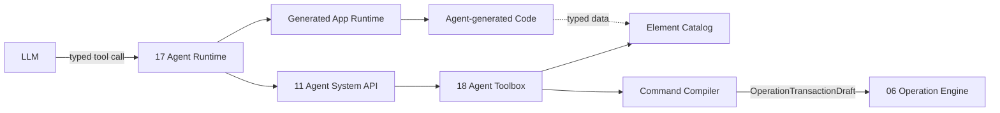

# 18 Agent Toolbox 模块设计

- 所有权：Rust
- 建议 crate：`crates/agentos-toolbox`
- 上游：Agent Runtime、Agent System API
- 下游：Operation Engine、Validator
- 核心原则：LLM 可以自由生成应用代码，但最终 UI 只能组合已注册的 Surface Element

## 1. 目标

Agent Toolbox 是 Agent 可构建 GUI 的权威能力目录。它把“系统允许构建什么”定义为版本化、类型化、可校验的 Element 注册表和少量受限命令。

首期目标：

1. 向 Agent 描述可用 Element、配置字段、尺寸和数据依赖；
2. 只允许 Agent 引用已注册的 `elementType`；
3. 将受限 Toolbox command 编译为领域 `OperationTransactionDraft`；
4. 在编译前校验配置、capability、Surface scope 和目录版本；
5. 让天气、音频、Podcast、计算器、视频、流媒体和财经新闻由同一套可组合 Element 构建；
6. 保持 Element UI、Agent 生成代码、Agent Prompt 和数据库 Schema 解耦。

## 2. 非目标

Toolbox 只限制 Agent 创建和修改的 UI 结构，不限制 Agent 生成的数据获取与业务逻辑代码。

Toolbox 不允许 Agent：

- 注册新 Element type、修改 JSON Schema 或加载插件；
- 绕过 Operation Engine 添加、删除或配置 Element；
- 将 Skill 文本解释为新的工具或 capability；
- 创建任意嵌套 UI 树。

PoC 阶段明确允许 Agent 生成任意应用实现代码，包括网络爬虫、API client、数据清洗、业务逻辑、调度、存储访问和所需依赖。Toolbox 不分析 import、URL、文件路径、Shell command、代码语言或实现方式，也不以 Catalog 拒绝这些内容。

生成代码的保存、构建、执行、日志和生命周期属于独立的 Generated App Runtime，不属于 Element Toolbox。未来 SDK 可以逐步提供稳定 API 并收紧执行权限，但不能反向改变“Toolbox 只裁决 UI Element”的所有权边界。

## 3. 核心分层



Toolbox 描述和编译 UI 能力，但不拥有 GUI 聚合，也不生成或执行应用代码。Operation Engine 仍是修改 `GuiDocument` 的唯一领域入口。Generated App Runtime 可以产生 Element 消费的数据，但不能注册新的 Element renderer。

## 4. 三个不同概念

### 4.1 Element Definition

描述一个可放入 Surface 的稳定构件：

```rust
pub struct ElementDefinition {
    pub type_id: ElementTypeId,
    pub version: ElementVersion,
    pub title: String,
    pub description: String,
    pub category: ElementCategory,
    pub config_schema: ConfigSchema,
    pub default_size: GridSize,
    pub size_constraints: SizeConstraints,
    pub required_capabilities: CapabilitySet,
    pub allowed_sources: Vec<DataSourceKind>,
    pub renderer_key: RendererKey,
    pub lifecycle: ElementLifecycle,
}
```

### 4.2 App Recipe

App Recipe 是面向用户意图的推荐组合，不是新的执行权限：

```rust
pub struct AppRecipe {
    pub recipe_id: RecipeId,
    pub title: String,
    pub description: String,
    pub elements: Vec<RecipeElement>,
    pub optional_elements: Vec<RecipeElement>,
    pub questions: Vec<RecipeQuestion>,
}
```

Recipe 只能引用 Catalog 已注册 Element。Agent 可以采用、删减或组合 Recipe，但最终仍输出受限 Toolbox command。

### 4.3 Generated App Binding

Element 可以绑定 Agent 生成应用的输出：

```rust
pub struct GeneratedAppBinding {
  pub app_id: GeneratedAppId,
  pub output_name: String,
  pub output_schema_version: u32,
}
```

Toolbox 只校验 binding 的输出是否满足 Element config/data contract，不限制该输出由爬虫、API client、本地程序、数据库查询或其他生成代码产生。PoC 阶段允许 Agent 自由选择实现方式。

## 5. Toolbox Catalog

```rust
pub trait ToolboxCatalog: Send + Sync {
    fn version(&self) -> ToolboxVersion;
    fn list(&self, filter: ToolboxFilter) -> Vec<ElementSummary>;
    fn describe(&self, type_id: &ElementTypeId) -> Result<ElementDefinition, ToolboxError>;
    fn recipe(&self, recipe_id: &RecipeId) -> Result<AppRecipe, ToolboxError>;
}
```

Catalog 是 `RuntimeDescriptor` 中 supported elements 的唯一事实源，并同时服务：

- `system.describeCapabilities`；
- Agent Prompt 的紧凑 Toolbox 索引；
- Shell 的“可添加元素”面板；
- Toolbox command 校验；
- 文档和 contract tests。

禁止在 Prompt、React renderer 和 Validator 中分别手写三份不一致的 Element 能力表。

## 6. 首期应用与元素拆解

### 6.1 公共基础元素

| Element type | 作用 | 核心配置 | 数据能力 |
| --- | --- | --- | --- |
| `time.panel` | 时间显示 | timezone、format、title | `LocalClock` |
| `text.panel` | 静态文本与受控 Surface link | title、runs | 无 |
| `app.icon` | 进入另一个 Surface | targetSurfaceId、title | `surface.read` |
| `media.transport` | 播放、暂停、前后跳转 | targetPlayerId、compact | 只控制同 Surface 已注册 player |
| `media.queue` | 当前队列和选集 | targetPlayerId、maxItems | 对应 player 的只读队列 |
| `collection.list` | 受控目录/列表选择 | sourceRef、itemLayout、limit | 已授权 catalog/library |
| `status.message` | loading、empty、offline、error | targetElementId、displayMode | 目标 Element 状态 |

### 6.2 天气

| Element type | 核心配置 | 数据能力 |
| --- | --- | --- |
| `weather.current` | locationSourceId、units、fields、refreshPolicy | `location.read`、`weather.read` |
| `weather.forecast` | locationSourceId、days 1..7、units | `weather.read` |

推荐 Recipe：`app.weather.local`

- 必需：`weather.current`；
- 可选：`weather.forecast`；
- 关键问题：系统定位还是用户选择城市；
- 禁止：Agent 自填经纬度追踪用户，或指定天气 API URL。

### 6.3 音乐播放器

| Element type | 核心配置 | 数据能力 |
| --- | --- | --- |
| `audio.player` | sourceRef、autoplay=false、repeatMode、volumePolicy | `media.audio.read`、`media.playback` |
| `media.transport` | targetPlayerId | player control |
| `media.queue` | targetPlayerId | queue read |
| `collection.list` | MediaLibraryId、mediaKind=music | `media.library.read` |

推荐 Recipe：`app.music.player`

`audio.player` 的 UI config 仍按 Schema 校验。Agent 生成的媒体索引、目录读取和播放辅助代码不由 Toolbox 限制。

### 6.4 Podcast 播放器

| Element type | 核心配置 | 数据能力 |
| --- | --- | --- |
| `podcast.player` | podcastCatalogId、showId、episodeId?、playbackRate | `podcast.read`、`media.playback` |
| `podcast.episodes` | podcastCatalogId、showId、sort、limit | `podcast.read` |
| `media.transport` | targetPlayerId、skipInterval | player control |

推荐 Recipe：`app.podcast.player`

Feed URL 不放入 `podcast.player` 的 UI config；Agent 可以在 Generated App 中自由实现 feed 获取、解析和缓存，再将输出绑定到该 Element。

### 6.5 计算器

| Element type | 核心配置 | 数据能力 |
| --- | --- | --- |
| `calculator.basic` | mode=basic、precision、historyPolicy | 本地确定性计算 |
| `calculator.scientific` | angleUnit、precision、enabledFunctions allowlist | 本地确定性计算 |

推荐 Recipe：`app.calculator`

`calculator.basic` 的 UI config 不携带可执行代码。Agent 可以自由生成计算器实现，包括 parser、`eval`、第三方库、LLM 调用或其他脚本；其输出与交互通过 Element contract 接入 Runtime。

### 6.6 视频播放器

| Element type | 核心配置 | 数据能力 |
| --- | --- | --- |
| `video.player` | mediaSourceId、fitMode、captionsTrackId?、autoplay=false | `media.video.read`、`media.playback` |
| `media.transport` | targetPlayerId | player control |
| `media.queue` | targetPlayerId | queue read |

推荐 Recipe：`app.video.player`

`video.player` 的 UI config 使用稳定 binding ID。Agent 生成代码可以处理真实路径、转码工具或媒体发现逻辑，Toolbox 不检查其实现。

### 6.7 流媒体播放器

| Element type | 核心配置 | 数据能力 |
| --- | --- | --- |
| `stream.player` | streamSourceId、qualityPolicy、latencyMode | `stream.read`、`media.playback` |
| `stream.catalog` | providerAccountId、category、limit | `stream.catalog.read` |
| `media.transport` | targetPlayerId | provider 允许的控制 |

推荐 Recipe：`app.streaming.player`

`stream.player` 的 UI config 使用稳定 binding ID。Agent 可以生成 provider adapter，并处理 manifest URL、cookie、DRM 集成或 header；这些实现细节不进入 Element config。

### 6.8 财经新闻

| Element type | 核心配置 | 数据能力 |
| --- | --- | --- |
| `finance.news` | financeFeedId、topics、markets、limit、refreshPolicy | `finance.news.read` |
| `finance.ticker` | financeFeedId、symbols、displayFields | `finance.quote.read` |
| `finance.watchlist` | watchlistId、displayFields | `finance.watchlist.read` |

推荐 Recipe：`app.finance.news`

新闻与行情必须显示 provider 和更新时间。Toolbox 不提供交易、下单或账户资产写入能力。

## 7. 分阶段 Catalog

Catalog 必须区分“设计目标”和“当前可用”，避免 Agent 虚构能力：

```rust
pub enum ElementAvailability {
    Available,
    Preview,
    Unavailable { reason: String },
}
```

当前实现基线：

| Element | 状态 |
| --- | --- |
| `time.panel` | Available |
| `text.panel` | Available |
| `app.icon` | Available |
| 其余媒体、天气、计算器、财经 Element | Preview，尚不能提交 |

Plan-only 可以描述 Preview Element 和前置依赖，但 Build 模式只能引用 `Available`。

## 8. Agent 可见工具

工具数量保持小，不为每个 Element 创建一个 tool。

### 8.1 只读工具

```text
toolbox.list
  filter?: { category?, availability? }

toolbox.describe
  typeId: ElementTypeId

toolbox.getRecipe
  recipeId: RecipeId
```

### 8.2 首期写工具

```text
element.add
  surfaceId
  typeId
  catalogVersion
  config
  placement: "auto"

element.remove
  surfaceId
  elementId
```

首期不向 Agent 开放任意 `operation.commit`。`element.add/remove` 由 Agent System API 转换为单一目的的 draft，仍经过 validate、确认和 commit 门。

### 8.3 后续受限工具

```text
element.configure
  surfaceId
  elementId
  expectedTypeId
  configPatch

element.move
  surfaceId
  elementId
  placement: GridPlacement
element.resize
  surfaceId
  elementId
  size: GridSize
```

这些工具只有在字段级 patch Schema、碰撞预览和确认策略完成后才开放。禁止 generic JSON Patch。

## 9. Toolbox Command

```rust
pub enum ToolboxCommand {
    AddElement(AddElementCommand),
    RemoveElement(RemoveElementCommand),
    ConfigureElement(ConfigureElementCommand),
    MoveElement(MoveElementCommand),
    ResizeElement(ResizeElementCommand),
}
```

```rust
pub struct AddElementCommand {
    pub surface_id: SurfaceId,
    pub type_id: ElementTypeId,
    pub catalog_version: ToolboxVersion,
    pub config: ElementConfig,
    pub placement: PlacementRequest,
}
```

Command Compiler：

```rust
pub trait ToolboxCommandCompiler: Send + Sync {
    fn compile(
        &self,
        context: &ToolboxCallContext,
        command: ToolboxCommand,
    ) -> Result<OperationTransactionDraft, ToolboxError>;
}
```

编译顺序固定：

1. 校验 session mode 和 capability；
2. 校验 Surface scope；
3. 校验 catalog version；
4. 查找 Element definition 和 availability；
5. 解析严格 config schema，拒绝未知字段；
6. 校验 Generated App binding 的输出 contract 与 Element 匹配；
7. 应用 UI 默认值和尺寸约束；
8. 生成最小 Operation draft；
9. 交由 Operation Engine 再做领域预检。

Toolbox 校验成功不代表领域提交成功。

## 10. 配置模型

配置必须是按 Element type 定义的 Rust enum/struct，不以无界 `serde_json::Value` 穿过应用层：

```rust
pub enum ElementConfig {
    TimePanel(TimePanelConfig),
    WeatherCurrent(WeatherCurrentConfig),
    AudioPlayer(AudioPlayerConfig),
    PodcastPlayer(PodcastPlayerConfig),
    Calculator(CalculatorConfig),
    VideoPlayer(VideoPlayerConfig),
    StreamPlayer(StreamPlayerConfig),
    FinanceNews(FinanceNewsConfig),
}
```

Transport 可以接收 JSON，但必须使用 discriminated union 且 `deny_unknown_fields`。字符串有长度限制，列表有数量限制，数值有范围限制，enum 不接受任意值。

## 11. Agent 灵活度边界

### MVP 允许

- 查看 Available/Preview Element 和 Recipe；
- 根据用户意图选择 Recipe；
- 对 Available Element 提出添加或删除；
- 从 allowlist 中选择显示字段、单位、排序等配置；
- 使用自动放置；
- 为 Element 绑定 Generated App 输出；
- 生成实现数据来源和业务逻辑所需的任意代码。

### MVP 不允许

- 创建新 Element type；
- 自定义样式、CSS、颜色表达式或组件层级；
- 任意移动、缩放和配置已有 Element；
- 删除受保护、正在构建或不在 session scope 的 Element；
- 将 Preview Element 当作已构建能力提交。

这些限制只适用于 Surface UI。生成代码在 PoC 阶段不受 Toolbox 类型、URL、依赖、语言或 API allowlist 限制。未来 SDK 的权限与沙箱策略属于 Generated App Runtime，不扩张或缩小 Element Catalog。

## 12. 与 Skills 的关系

- Toolbox 定义“能做什么”，是可执行能力的唯一事实源；
- Skill 定义“在某类需求下如何选择和组合”，只是受信任说明；
- Recipe 定义“常见组合的机器可读默认值”；
- capability 定义“本次会话允许使用什么”；
- Operation Engine 定义“这次变更是否合法”。

Skill 不得定义 Element、Tool、Schema、source adapter 或 capability。天气 Skill 可以建议 `app.weather.local` Recipe，但不能创造 `weather.current`。

## 13. 权限与确认

建议 capability：

```text
toolbox.read
element.add
element.remove
element.configure
element.move
element.resize
```

首期 Build session 默认最多签发：

```text
toolbox.read
element.add
element.remove
```

确认建议：

| 动作 | 默认确认 |
| --- | --- |
| 查看 Catalog/Recipe | none |
| 添加无敏感数据的本地 Element | user review of transaction summary |
| 添加需要定位、账户、目录或网络 source 的 Element | user |
| 删除普通 Element | user |
| 删除含用户数据或队列状态的 Element | user + impact warning |
| 配置、移动、缩放 | 后续策略 |

Agent 只能请求确认；Shell 是唯一 resolver。

## 14. 版本与兼容

- `ElementTypeId` 稳定，例如 `weather.current`；
- `ElementVersion` 描述配置 Schema；
- `ToolboxVersion` 描述完整目录快照；
- command 必须携带模型看到的 `catalogVersion`；
- Catalog 更新后旧 command 返回 `CATALOG_VERSION_CONFLICT`，要求重新 describe；
- 已持久化 Element 保留创建时版本，由 migration adapter 升级；
- 删除或重命名 type 必须经历 Deprecated -> Unavailable，不静默复用 ID。

## 15. 错误

```rust
pub enum ToolboxError {
    TypeNotFound,
    TypeUnavailable,
    CatalogVersionConflict,
    InvalidConfig,
    UnknownConfigField,
    BindingContractMismatch,
    CapabilityDenied,
    SurfaceOutOfScope,
    ProtectedElement,
    UnsupportedCommand,
    DomainValidationFailed,
}
```

错误包含稳定 reason、字段 path、可恢复性和建议动作，不包含 credential、真实文件路径或 provider response body。

## 16. 测试

### Catalog contract

- type ID 唯一，version 单调；
- config、renderer、Domain mapping 完整；
- Recipe 只引用存在的 Element；
- Available Element 必须有 renderer 和 Operation mapping；
- Preview Element 不能编译为写操作；
- Prompt、Shell 和 API 导出的 Catalog hash 相同。

### Command compiler

- 未知 type、未知 UI 字段、越界值和 binding contract mismatch 拒绝；
- 未授权 Surface 和 Element mutation capability 拒绝；
- 同一输入产生确定性 draft；
- `placement=auto` 不接受模型坐标；
- 删除 protected/building/out-of-scope Element 拒绝；
- Catalog version drift 拒绝；
- 编译结果仍必须通过 Operation Engine。

### 安全

- 任意生成代码不能伪造或注册新的 Element type；
- 代码文本、URL、path、header 和 SQL 不作为 Element config 穿过 Operation Engine，而由 Generated App Package 独立保存；
- Skill 内容不能注册 type 或扩大 capability；
- `serde(deny_unknown_fields)` transport contract；
- 任意 JSON fuzz 不触发 panic 或无界分配；
- Secret 不出现在 Catalog、Prompt、错误和审计事件。

### Golden scenarios

每类应用至少有一个计划和一个受限 command fixture：

1. 当地天气：Agent 可以生成天气 API client 或网页爬虫，但 UI 仍引用 `weather.current`；
2. 音乐：Agent 可以生成媒体索引逻辑，但播放 UI 仍引用注册的 player Element；
3. Podcast：Agent 可以生成 feed parser 并自由处理 URL；
4. 计算器：Agent 可以生成计算实现，但 UI 仍引用注册的 calculator Element；
5. 视频：Agent 可以生成媒体发现与转换逻辑；
6. 流媒体：Agent 可以生成 manifest、header 和 provider 适配逻辑；
7. 财经新闻：无交易 capability，显示 provider 与更新时间。

## 17. 分阶段实施

### Slice T1：Catalog 与只读描述

- 建立 Toolbox crate；
- 注册当前 `time.panel`、`text.panel`、`app.icon`；
- 其余目标 Element 注册为 Preview；
- Runtime Descriptor 和 `system.describeCapabilities` 从 Catalog 生成；
- 提供 `toolbox.list/describe/getRecipe`。

### Slice T2：受限 add/remove 草案

- 实现 `element.add/remove` command；
- 只对当前三个 Available Element 开放；
- 自动放置；
- 严格 config 和 Catalog version；
- 只做到 validate 和用户预览，暂不自动 commit。

### Slice T3：Generated App 编程能力验证

- Agent 根据用户需求生成一个完整数据获取程序；
- 不限制语言、依赖、URL、网络爬虫或业务逻辑实现；
- 保存并展示生成文件、构建日志和运行输出；
- 将输出绑定到一个已注册 Element；
- 验证应用脱离 Agent 后仍可再次运行。

### Slice T4：本地播放器基础

- 抽象 `media.transport` 与授权 source reference；
- 先实现单一音频或视频播放器，不同时实现全部媒体应用；
- 验证 player-target 引用与删除影响。

### Slice T5：其余 Recipe

按风险和共享能力逐个增加 Podcast、另一个本地媒体类型、流媒体、财经新闻。计算器可独立推进，因为无需外部数据 source。

## 18. 待决事项

1. 媒体 player 是单一 `media.player` + kind，还是 audio/video/podcast 分离类型；
2. Recipe 是否允许创建子 Surface，首期建议不允许；
3. Element 配置迁移归 Toolbox 还是 GUI Domain adapter；
4. source authorization 的 UI 与撤销行为；
5. 删除 Element 时播放队列、历史和缓存的保留策略；
6. 财经行情 refresh 限流和市场延迟标识；
7. Preview Element 是否对普通用户可见，还是只对 Agent plan-only 可见。

## 19. 验收标准

1. Agent 只能使用 Catalog 中已注册且 Available 的 Element；
2. 首期 Agent 写能力只有 add/remove，且 placement 自动；
3. 未知字段、类型、source 和 capability 在生成 Operation draft 前被拒绝；
4. Toolbox、Prompt、Shell 和 Agent API 使用同一 Catalog；
5. Skill 和 Recipe 均不能扩大可执行能力；
6. 任何写入仍经过 validate、用户确认和 Operation Engine；
7. 七类目标应用被拆成可复用 Element，但数据来源与业务逻辑允许 Agent 自由编程；
8. Toolbox 不依赖数据库、provider SDK、Shell、文件系统或模型供应商。
