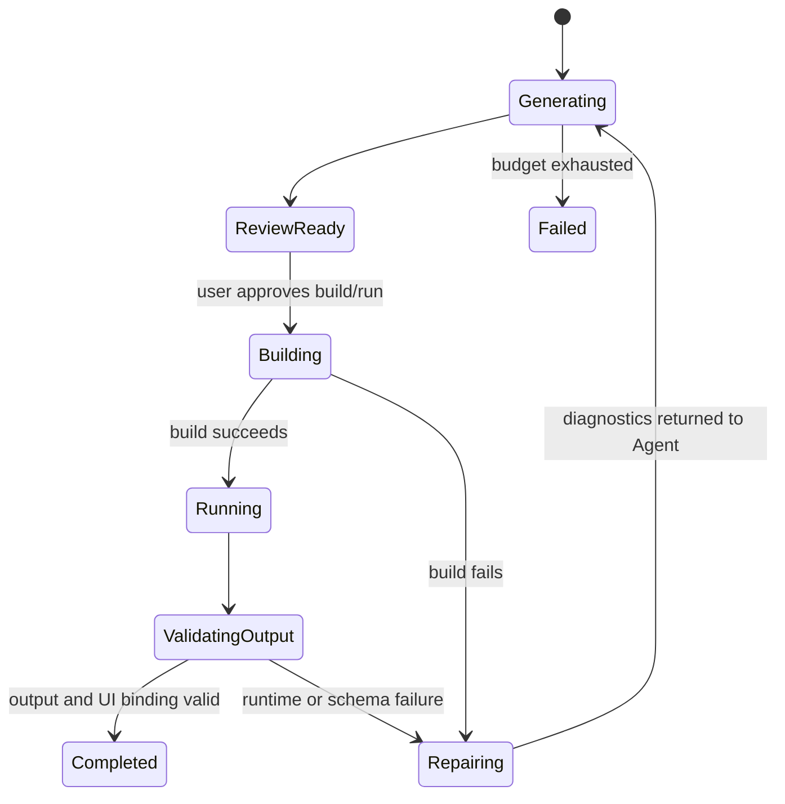

# 19 Generated App Runtime 模块设计

- 所有权：Rust/Tokio + 独立子进程
- 建议 crate：`crates/agentos-generated-app-runtime`
- 上游：Build Orchestrator、Agent Runtime
- 下游：Generated App workspace、process runner、Element data binding
- PoC 原则：不限制 Agent 生成的代码，只限制最终 UI 使用注册的 Surface Element

## 1. 要验证的命题

AgentOS PoC 需要验证：用户描述任意系统后，Agent 能否自主设计并实现数据来源、网络爬虫和业务逻辑，同时将结果呈现在稳定的 Surface UI 中。

这一阶段不验证 SDK allowlist 是否完整，也不以生产级沙箱为前置条件。核心闭环是：

```text
用户需求
  -> Agent 生成任意应用代码
  -> 构建与运行
  -> 根据诊断修复
  -> 产生数据或事件
  -> 绑定到已注册 Element
  -> Agent 下线后仍可重复运行
```

## 2. Surface Agent 职责边界

当前切片聚焦 Surface Agent。它负责选择和配置数据 Provider、组装 Provider 输出、轻量字段映射与格式化、基于已有权威字段的展示过滤和排序、展示状态、Element 选择以及 UI binding。

摘要、分类、实体抽取、语义去重、多源融合、推荐或相关性评分、业务指标计算等复杂加工不属于 Surface Agent。它们由后续独立的 Data Provider Agent 生成 Provider Package，并通过版本化 output schema 提供。Surface Agent 可以消费 Provider 已明确提供的 `summary`、`category`、`importance` 或指标字段，但不能在字段缺失时自行实现加工算法、截断正文冒充摘要或使用代理字段改变业务含义。

当用户体验依赖尚不存在的 Provider 能力时，Surface Agent 必须在方案中写明所需 capability 和 output field，并保持未就绪；不得把复杂加工重新塞回展示应用。当前切片只建立这条职责边界，不实现 Provider Agent、Provider Catalog 或 Provider Package 生命周期。

## 3. 唯一硬边界

PoC 只硬性约束 UI：

1. Surface 上只能创建 Agent Toolbox 中 `Available` 的 Element；
2. Agent 不能生成新的 React renderer 并注入主 WebView；
3. Element config 必须通过对应的类型化 Schema；
4. Generated App 输出必须满足目标 Element 的 data contract；
5. Surface mutation 仍经过 Operation Engine。

这些约束不延伸到 Generated App 的内部实现。

## 4. 生成代码自由度

Agent 可以生成：

- 任意编程语言；
- 任意数量和目录结构的文件；
- 网络爬虫、HTTP client、浏览器自动化；
- HTML/JSON/RSS parser；
- SQL、文件读写、缓存和索引；
- Shell script、build script 和 migration；
- npm、Cargo、pip 或系统依赖声明；
- `eval`、动态加载、子进程和第三方 SDK；
- API endpoint、header、cookie、credential binding 和 provider adapter；
- 定时任务、后台服务和业务规则。

PoC 的代码生成路径不维护 import、package、域名、URL、语言、命令或 API allowlist，也不因为代码包含上述内容而拒绝保存或构建。

Surface Agent 的职责边界与代码 allowlist 是两件事：展示应用仍可自由选择实现语言、依赖和 Provider 集成方式，但不能承担应由 Data Provider Agent 提供的复杂数据加工语义。

## 5. Generated App Package

系统只要求一个最小控制清单，不规定应用源码结构：

```rust
pub struct GeneratedAppManifest {
    pub app_id: GeneratedAppId,
    pub display_name: String,
    pub working_directory: String,
    pub build_commands: Vec<ProcessCommand>,
    pub run_command: ProcessCommand,
    pub outputs: Vec<GeneratedOutputDefinition>,
    pub ui_bindings: Vec<ElementBindingDraft>,
}
```

```rust
pub struct ProcessCommand {
    pub program: String,
    pub args: Vec<String>,
    pub environment: Vec<EnvironmentBinding>,
}
```

`build_commands` 和 `run_command` 由 Agent 自由生成。PoC 不将其编译成封闭 SDK 调用。

Manifest 是 Runtime 控制面，不是应用实现 Schema。应用可在其 workspace 内采用任何结构。

## 6. 输出协议

为了将任意程序连接到稳定 UI，Generated App 至少声明一个输出。首期使用 JSON Lines over stdout：

```json
{"type":"recordBatch","output":"articles","schemaVersion":1,"records":[...]}
{"type":"state","output":"articles","status":"ready","updatedAt":"..."}
{"type":"diagnostic","level":"info","message":"fetched 20 articles"}
```

Runtime 只解析带协议 envelope 的行；其他 stdout/stderr 作为原始构建或运行日志保留。

```rust
pub struct GeneratedOutputDefinition {
    pub name: String,
    pub schema_version: u32,
    pub json_schema: serde_json::Value,
}
```

Agent 可以自由设计 output JSON Schema。绑定到 Element 时，Validator 检查 output contract 与 Element data contract 是否兼容。

## 7. 生成与修复循环



首期默认：

- 最多 3 次生成/修复轮次；
- 每次由 Agent Ledger 保留完整文件快照与展示 diff、command、stdout、stderr 和 exit code；
- Agent 可以修改任意生成文件和命令；
- 不自动修改 AgentOS Host 或 Element renderer；
- 用户可以在首次 build/run 前查看 package 和命令；
- 用户确认是执行时机控制，不是代码内容 allowlist。

## 8. 公共接口

```rust
#[async_trait]
pub trait GeneratedAppRuntime: Send + Sync {
    async fn materialize(
        &self,
        draft: GeneratedAppPackageDraft,
    ) -> Result<GeneratedAppPackage, GeneratedAppError>;

    async fn build(
        &self,
        app_id: &GeneratedAppId,
        sink: Box<dyn ProcessEventSink>,
        cancellation: CancellationToken,
    ) -> Result<BuildExecution, GeneratedAppError>;

    async fn run(
        &self,
        app_id: &GeneratedAppId,
        sink: Box<dyn ProcessEventSink>,
        cancellation: CancellationToken,
    ) -> Result<RunExecution, GeneratedAppError>;
}
```

Agent Runtime 生成 package draft 和修复补丁；Generated App Runtime 拥有 workspace materialization 与 process lifecycle。

所有 `materialize`、`build` 和 `run` 行为在执行前后写入 Agent Ledger。任何 build/run 必须绑定精确 package revision；Ledger 写入失败时不得创建文件或启动进程。

## 9. 与 Agent Toolbox 的关系

- Generated App Runtime 决定“代码如何构建和运行”；
- Agent Toolbox 决定“哪些 UI Element 可以出现在 Surface”；
- output schema 连接两者；
- Toolbox 不读取源码来判断是否合法；
- Generated App Runtime 不能注册新的 Element type；
- Agent 可以重写 Generated App 的全部代码，而无需改变 Element renderer。

## 10. PoC 执行模型

PoC 第一阶段允许直接在独立子进程中执行 Agent 提供的 command，以尽快验证编程闭环。执行前 UI 必须显示：

- 将创建或修改的文件；
- build/run command；
- working directory；
- 声明的环境变量名称；
- 目标 UI Element 与 output binding。

用户确认后执行。取消 BuildTask 时终止进程树。

这是有意接受的 PoC 风险，不代表生产安全模型。生成代码 workspace 必须与 AgentOS 源码 workspace 分离，避免一次应用构建直接覆盖 Host 源码。

## 11. SDK 演进

SDK 不是首期生成能力的限制条件，而是后续提高稳定性和可移植性的工具：

### Phase 0：自由代码

- Agent 自选语言、依赖和 command；
- stdout JSON Lines 输出；
- 用户 review 后运行；
- 验证 Agent 编程与修复能力。

### Phase 1：可选 SDK

- 提供 HTTP、records、logging、schedule helper；
- Agent 可以使用，也可以继续直接调用第三方库；
- 收集常见失败模式。

### Phase 2：默认 SDK

- Prompt 优先建议 SDK；
- 对网络、Secret、存储提供更稳定 contract；
- 非 SDK 实现仍可通过高级模式运行。

### Phase 3：生产策略

- 根据 PoC 数据决定 sandbox、egress、Secret、依赖和资源策略；
- 收紧发生在执行策略，不发生在代码生成能力；
- UI Element Catalog 继续作为独立硬边界。

## 12. 首个验证切片 P1

当前已实现 P1a：真实 Agent 在方案通过质量门后生成 UTF-8 文本 package、Host-owned
Manifest、源码与测试文件；Runtime 校验相对路径、重复文件、output/UI binding 引用和
已审核 Toolbox binding，先将完整 revision 写入 Agent Ledger，再原子物化到独立
workspace。P1a 不安装依赖、不执行 build/run、不解析 stdout，也不提交 Surface
Operation。后续 P1b 必须在用户查看文件和命令并明确确认后，才能执行精确 revision 的
build/run。

当前已实现 P1b 的 build 部分：用户明确确认后，Runtime 绑定精确 package revision，
按 Manifest 顺序执行 buildCommands；每条命令在启动前记录 program、args、cwd、环境
变量名称和 confirmation，启动后记录 PID，结束后将完整 stdout/stderr 原始字节和
exit code 写入 Agent Ledger。任一命令非零退出即停止后续命令。P1b build 不执行
runCommand、不解析应用 JSONL、不进行自动修复，也不提交 Surface Operation。

目标：验证 Agent 可以编写并修复一个网络数据应用，而不是只输出方案。

1. 用户输入一个财经新闻或任意网页数据需求；
2. Agent 生成完整 package、manifest、源码和 commands；
3. 调试界面展示文件树和源码；
4. 用户确认 build/run；
5. Runtime 执行命令并收集诊断；
6. 失败时诊断回传 Agent，最多修复 3 次；
7. 成功时解析 JSON Lines records；
8. records 绑定到一个注册的通用列表 Element；
9. 不调用 Agent 再次运行，证明应用可独立工作。

首个切片不要求 bubblewrap、域名 allowlist、依赖 allowlist或统一 HTTP SDK。

## 13. 测试与验收

### Package

- 可保存任意文本或二进制生成文件；
- command 和 args 保持原样，不做 Shell 字符串重写；
- workspace 与 AgentOS source root 分离；
- 相同 app ID 的更新有 revision；
- 取消时终止进程树。

### 编程闭环

- Stub Agent 生成一个可运行 package；
- 真实 Agent 根据需求生成 package；
- build 失败诊断可以触发修复；
- 修复后可再次 build/run；
- stdout 非协议行不会破坏 output parser；
- output schema 不匹配时不能绑定 UI；
- 未注册 Element type 始终被 Toolbox 拒绝。

### 验收标准

1. Agent 生成代码不受语言、依赖、URL、import 或实现方式限制；
2. 用户可以查看所有生成文件与实际执行命令；
3. 至少一次真实 Agent 生成、构建、运行和修复闭环成功；
4. 生成程序脱离 Agent 后可以再次运行；
5. 生成输出可以绑定到已注册 Element；
6. 任意代码不能注册或注入新的 Surface renderer；
7. SDK 收紧不作为 P1 的前置条件。
